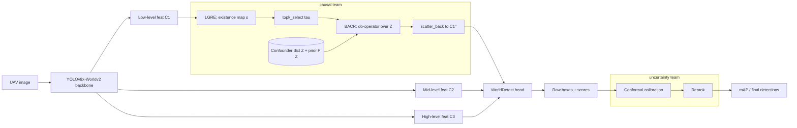
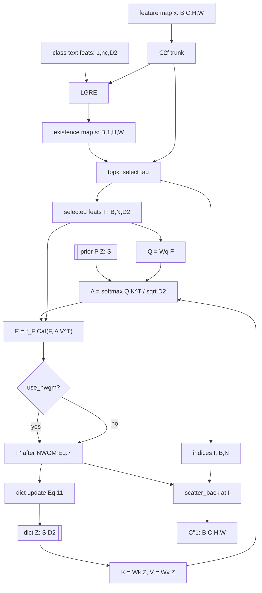
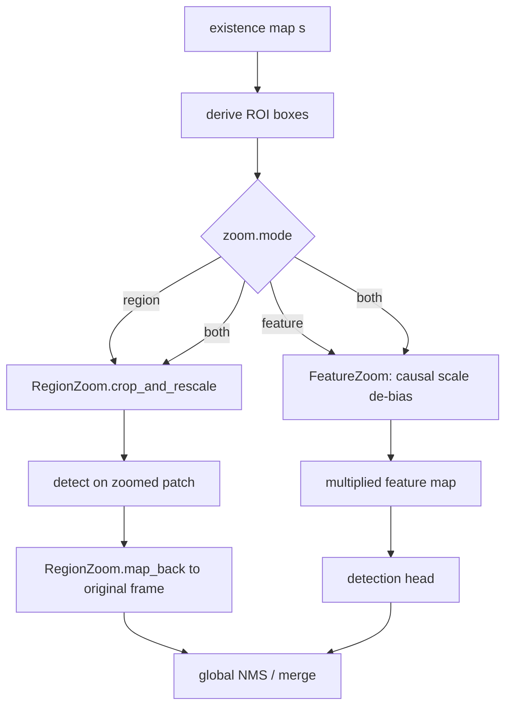
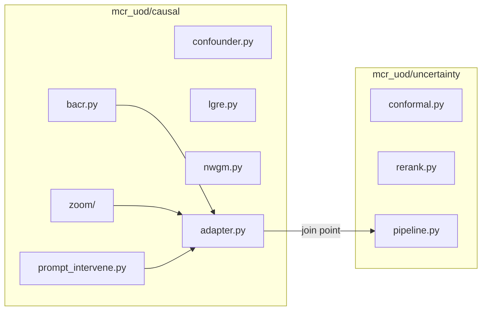

# Architecture — MCR-UOD causal package

Diagrams for the causal half of *Uncertainty-guided causal reasoning for
multimodal object detection*. See `../README.md` for the interface contract.

## 1. Overall pipeline



## 2. Causal module data flow



## 3. Zoom strategies



## 4. Prompt intervention (MT2)

```mermaid
flowchart LR
    CLASS[class names] --> BANK[PromptBank: attribute-enriched prompts]
    ATTR[attributes: colour, shape, view] --> BANK
    BANK --> CLIP[CLIP text encoder]
    CLIP --> LOGITS[per-context logits: B,S,nc]
    PRIOR[[prior P Z: S]] --> PI[PromptIntervener]
    LOGITS --> PI
    PI --> OUT[P Y | do T logits: B,nc]
```

## 5. Ownership boundaries



## 6. Where this hooks into YOLO

`registry.py::register_causal_modules` monkey-patches the causal block into
`ultralytics.nn.modules` so `parse_model` can resolve it from a model YAML.
This replaces the upstream hook at
`ultralytics/nn/tasks.py::WorldModel.forward` (currently `C2fAttn`).
